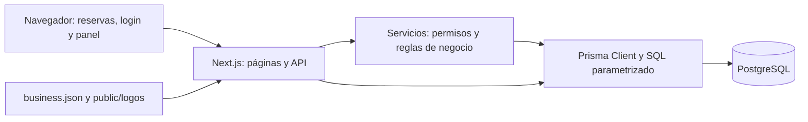

# Contexto técnico y funcional de Agenda Web

## Finalidad

Agenda Web es una plantilla de reservas y operación para negocios que atienden por cita. Nació para barberías y puede adaptarse a peluquerías, salones y centros de estética con un modelo similar de servicios, profesionales y horarios. Los clientes consultan el catálogo, eligen quién los atiende y agendan una cita. El equipo gestiona las reservas, la disponibilidad, el catálogo, el personal y los indicadores de ventas y comisiones.

La estrategia de entrega es un repositorio base en GitHub y una copia privada por cliente, con su propia aplicación, configuración de marca y base de datos. El esquema representa un negocio por instalación. La moneda de la interfaz es COP, el formato es `es-CO` y la agenda usa `America/Bogota`. Adaptar esa operación a otros países o a varias sedes requiere cambios de reglas y del modelo de datos. [Marca](config/business.json) · [Reloj de agenda](config/schedule.js) · [Esquema](prisma/schema.prisma)

## Arquitectura y mapa del código

Next.js App Router sirve las páginas y las rutas de API desde la misma aplicación. Los componentes de servidor cargan los datos iniciales. Los componentes con `'use client'` gestionan formularios, selección de fechas y actualizaciones de pantalla. En general, las rutas validan la entrada y verifican permisos, los servicios aplican las reglas de negocio y Prisma accede a PostgreSQL. Algunas rutas de consulta usan Prisma directamente.

| Ubicación | Responsabilidad |
| --- | --- |
| [`app/page.js`](app/page.js), [`app/reserva/`](app/reserva), [`app/login/`](app/login) | Portada, catálogo, elección del profesional, disponibilidad, confirmación, acceso y recuperación. |
| [`app/dashboard/`](app/dashboard), [`components/`](components) | Panel privado y componentes reutilizables, como calendario, tarjetas de citas, navegación y logo. |
| [`app/api/`](app/api) | Contratos HTTP públicos y autenticados. Cada `route.js` publica los métodos que exporta. |
| [`services/`](services) | Autenticación, límites de recuperación, usuarios, catálogo, agenda, citas, finanzas y patrones de cancelación. |
| [`config/`](config), [`utils/`](utils) | Identidad, roles, franjas, reglas de seguridad, formatos, validación Zod, sesión, Prisma y actualización de vistas. |
| [`prisma/`](prisma) | Modelos, relaciones, índices y migraciones de PostgreSQL. |
| [`public/`](public), [`app/globals.css`](app/globals.css) | Archivos de marca y variables CSS que consume Tailwind. |

## Módulos y puntos de entrada

| Módulo | Vista y API | Comportamiento |
| --- | --- | --- |
| Catálogo público | `/reserva`, `/reserva/[serviceId]`, `GET /api/services`, `GET /api/public/barbers` | Muestra servicios activos y profesionales activos asignados al servicio, con foto y descripción. |
| Reserva pública | `/reserva/agendar/[barberoId]`, `GET /api/public/availability`, `POST /api/appointments` | Selección de fecha y hora, revisión de datos, creación de cita y comprobante con referencia. |
| Cancelación pública | `POST /api/public/appointments/[id]/cancel` | Cancela con la referencia de la cita y el teléfono del cliente. El comprobante permite iniciar la cancelación. |
| Acceso | `/login`, `/login/recover`, `/api/auth/*` | Autenticación de personal, cierre de sesión, registro y recuperación por código. |
| Calendario y Reservas Día | `/dashboard`, `/dashboard/reservas`, `GET /api/appointments`, `PUT /api/appointments/[id]` | Calendario consulta una fecha elegida. Reservas Día usa la fecha de hoy. Comparten lista, filtros de profesional y servicio, detalle y cancelación. |
| Equipo | `/dashboard/barberos`, `/api/users`, `/api/users/[id]` | Alta, edición, asignación de servicios, comisión, pausa reversible y baja lógica. |
| Servicios | `/dashboard/servicios`, `/api/services`, `/api/services/[id]` | Administra el catálogo. `PATCH` cambia el estado y `DELETE` archiva de forma lógica. |
| Agenda | `/dashboard/agenda`, `/api/schedule`, `/api/schedule/[barberId]` | Horario recurrente del equipo y excepciones por fecha para un profesional. |
| Reportes y Contabilidad | `/dashboard/contabilidad`, `GET /api/finances`, `PATCH /api/finances/[barberId]` | Indicadores de operación y ventas, ranking, cancelaciones, liquidación y configuración de comisiones. |

## Roles y alcance

La sesión del personal se verifica en el servidor. La navegación oculta algunas opciones según el rol, y la autorización efectiva se comprueba en cada ruta o servicio. [Sesión](utils/auth.js) · [Navegación](components/DashboardSidebar.js)

| Rol | Permisos vigentes |
| --- | --- |
| `ADMIN` | Consulta citas y cifras del equipo. Gestiona perfiles, catálogo y ajustes de liquidación. La agenda, la consulta del catálogo con inactivos y las acciones dedicadas de reactivación y archivo de servicios requieren este rol. |
| `BARBER_BOSS` | Consulta y opera sobre citas del equipo, gestiona perfiles y ajustes de liquidación. La API le permite crear, editar y pausar servicios. |
| `BARBER_AFFILIATE` | Consulta y cambia estados de sus propias citas. La API de finanzas devuelve solo sus cifras. Puede actualizar los campos permitidos de su propio perfil. |
| `BARBER_INDEPENDENT` | Consulta y cambia estados de sus citas y tiene cifras personales por API. La ruta de registro permite su alta pública y la API vigente le permite crear, editar y pausar servicios del catálogo compartido. |
| Cliente | Reserva y cancela en el flujo público. Se identifica por teléfono dentro de `Clients`. |

El panel de equipo muestra administradores, jefes y afiliados. La Agenda aplica a jefes y afiliados sin archivar, y la vista de Contabilidad del equipo está disponible para administrador y jefe. Para modificar permisos, revisar en conjunto el menú, la página y sus rutas HTTP. [Equipo](services/user.service.js) · [Agenda](app/api/schedule/route.js) · [Catálogo](app/api/services/%5Bid%5D/route.js) · [Registro](app/api/auth/register/route.js)

## Reglas de operación

### Catálogo, equipo y agenda

- Un servicio tiene nombre, descripción, precio y duración en minutos. `ServicesBarbers` enlaza servicios con profesionales. Las fotos admiten URL válida o un JPEG pegado o seleccionado, que la interfaz comprime para guardar como URL de datos. [Catálogo](services/service.service.js) · [Campo de foto](components/BarberPhotoField.js) · [Validaciones](utils/validations.js)
- Pausar mantiene el registro y permite reactivarlo. Archivar establece `archivedAt` y retira el registro de las listas operativas, conservando citas e historial. El retiro y la desactivación del profesional comprueban que sus citas pendientes o confirmadas estén resueltas. [Usuarios](services/user.service.js#L77) · [Servicios](services/service.service.js#L67)
- La agenda semanal usa `BusinessHour`; el editor general guarda franjas por día para los miembros alcanzados y permite copiar horarios entre días. La agenda individual usa `ScheduleException` para un profesional y una fecha. Una excepción por hora prevalece sobre la de día completo y ambas prevalecen sobre la semana. El servidor comprueba conflictos con citas pendientes o confirmadas antes de cerrar horarios. [Horario](config/schedule.js) · [Agenda](services/schedule.service.js)

### Reservas y cancelaciones

1. La interfaz filtra por servicio y profesional. El servidor publica los días con cupos y distingue franjas disponibles de ocupadas. Un día sin cupos queda deshabilitado.
2. Al confirmar, el backend valida el horario, la relación entre servicio y profesional, los bloqueos del cliente y la ocupación. Crea la cita como `PENDING`, conserva el precio vigente y escribe el evento inicial. La unicidad de profesional, fecha y hora de inicio protege contra dos reservas simultáneas de la misma franja.
3. La API privada permite `CONFIRMED`, `COMPLETED` y `CANCELLED` sobre citas abiertas. El panel actual expone cancelación. Completar una cita se hace mediante el cambio explícito de estado en la API; el paso de la hora por sí solo no modifica su estado. El historial guarda la identidad y el rol del actor cuando están disponibles.
4. Una cancelación del cliente antes de la cita y con menos de 12 horas de anticipación suma una falta. Tres faltas reinician ese contador y bloquean las reservas del número por siete días. El tercer bloqueo es permanente. El estado se puede consultar en Reportes.

La disponibilidad actual cuenta cualquier cita en la misma franja, incluso cancelada. La regla de unicidad es por hora de inicio; no se calcula el solapamiento según la duración del servicio. Las pantallas se actualizan sin recargar mediante consultas cada dos segundos mientras la pestaña está visible y avisos `BroadcastChannel` entre pestañas del mismo origen. [Disponibilidad](app/api/public/availability/route.js) · [Citas](services/appointment.service.js) · [Actualización de vistas](utils/liveSchedule.js)

### Contabilidad y reportes

- Solo las citas `COMPLETED` suman ventas. El precio se guarda al reservar y la comisión y modalidad se toman al completar. Los registros anteriores sin esos valores se presentan como estimados con la configuración vigente.
- Los períodos son mensual o semestral, agrupados por la fecha de la cita. Se muestran ventas, participación del profesional y del negocio, servicios realizados y liquidación informativa. La modalidad indica si el negocio liquida al profesional o si el profesional entrega la participación del negocio.
- Reportes compara profesionales y servicios, frecuencia de clientes, cancelaciones por autor y faltas de clientes. Los porcentajes de cancelación se calculan sobre las citas programadas del conjunto correspondiente. Los patrones señalan series de cancelaciones, horas repetidas, cancelaciones cerca de la cita y jornadas pasadas con baja proporción completada. Son indicadores para revisión humana. [Finanzas](services/finance.service.js) · [Patrones](services/cancellation-patterns.js)

### Autenticación y recuperación

- El personal entra con teléfono y contraseña. `bcryptjs` comprueba la contraseña. `jsonwebtoken` firma el JWT y `jose` lo verifica. La sesión dura un día, se guarda en una cookie HttpOnly y se invalida en la verificación si el usuario está desactivado, archivado o cambió de rol.
- Login tiene un límite en memoria de cinco solicitudes por minuto por IP y bloqueo de cuenta de 15 minutos tras cinco errores. Recuperación tiene contadores persistentes en PostgreSQL: tres solicitudes por IP cada 15 minutos, tres por número por hora y 60 segundos entre envíos. Sin cabecera de IP confiable se usa una cuota compartida.
- El OTP de seis dígitos vence a los cinco minutos y se invalida al usarlo o tras cinco errores. Solo se emite para cuentas activas. La respuesta de solicitud y el cronómetro son uniformes. El OTP aparece en la terminal de desarrollo. El envío por WhatsApp o SMS está pendiente y la recuperación por código está deshabilitada en producción. [Autenticación](services/auth.service.js) · [Límites](services/recovery-rate-limit.js) · [Ajuste del proxy](README.md#límite-de-recuperación-por-ip)

## Datos y herramientas

| Pieza | Uso |
| --- | --- |
| PostgreSQL 15 en Compose y Prisma 5.22 | Persistencia, relaciones, migraciones y transacciones. `User` representa al personal, `Clients` a los clientes, `Appointment` a las citas y `HistoryAppointment` a sus eventos. Los horarios, las asignaciones y los controles de acceso y recuperación tienen sus propios modelos. |
| Next.js 16.4.5, React 19.3 y Node.js | App Router, SSR, API, navegación y componentes interactivos. Docker declara la base `node:20-alpine` y Next genera salida `standalone`. |
| Tailwind CSS 4, PostCSS y CSS Modules | Utilidades, tema dinámico y animación del comprobante. Las variables de marca salen de `business.json` a través del layout. |
| Zod 4 | Validación de entradas en las rutas; los formularios principales usan React y validación HTML. `react-hook-form` y `@hookform/resolvers` figuran en las dependencias, pero no se encontraron importaciones en los módulos actuales. |
| Lucide React, React Icons y Next Image | Iconos de interfaz y redes, y carga del logo. Geist y Geist Mono se configuran con `next/font`. |
| pnpm, ESLint y Git | Instalación reproducible, análisis estático y gestión del repositorio base y las copias. Las versiones exactas se toman de `package.json` y `pnpm-lock.yaml`. |

[Dependencias](package.json) · [Esquema Prisma](prisma/schema.prisma) · [Configuración Next](next.config.mjs)

## Docker, desarrollo y despliegue

La topología actual tiene dos servicios. `db` ejecuta PostgreSQL y guarda sus archivos en el volumen `pgdata`. `app` ejecuta Next.js y sirve tanto la interfaz como las rutas HTTP. Las etapas `deps`, `builder` y `runner` del Dockerfile construyen una sola imagen final de la aplicación.

| Modalidad | Arranque | Conexión de Next a PostgreSQL |
| --- | --- | --- |
| Desarrollo en el equipo | `docker compose up -d db` desde `agenda-web/` y `pnpm dev` desde esa misma carpeta | Para usar el PostgreSQL de Compose, `DATABASE_URL` apunta a `localhost:5433`. |
| Ambos servicios en Docker | `docker compose up -d --build` desde `agenda-web/` | `app` usa `db:5432` por la red interna de Compose. La web se publica actualmente en el puerto `3000` del equipo. |

Para una base nueva, aplicar el historial con `pnpm exec prisma migrate deploy` usando la URL del entorno correcto y generar el cliente con `pnpm exec prisma generate`. En una base existente que recibió cambios manuales, primero verificar qué migraciones ya están reflejadas y reconciliar el historial. El Compose actual no ejecuta migraciones al arrancar. La imagen final `standalone` ejecuta `node server.js`; planificar las migraciones como tarea separada con Prisma CLI. El registro de personal requiere una cuenta autorizada y el repositorio no incluye una inicialización automatizada del primer administrador. [Compose](docker-compose.yml) · [Dockerfile](Dockerfile) · [Migraciones](prisma/migrations)

### Mejoras recomendadas para despliegue

1. Inyectar `DATABASE_URL`, credenciales de PostgreSQL y `JWT_SECRET` al ejecutar. El Compose revisado contiene credenciales fijas y no declara `JWT_SECRET` para `app`. Retirar la URL con credenciales de los argumentos de compilación y verificar que la imagen se construya sin consultar la base del cliente.
2. Añadir un `healthcheck` con `pg_isready` y esperar a `service_healthy`. Ejecutar las migraciones antes de habilitar tráfico. Validar el flujo con PostgreSQL recién iniciado y con un volumen existente. [Orden de inicio en Docker Compose](https://docs.docker.com/compose/how-tos/startup-order/)
3. En un host compartido, usar un nombre de proyecto Compose por cliente y retirar los nombres de contenedor fijos. Mantener un volumen o base propios por instancia y evitar conflictos de puertos. En producción, usar un proxy HTTPS y mantener PostgreSQL en la red interna si solo lo consume la app. Configurar `RECOVERY_CLIENT_IP_HEADER` solo si el proxy controla esa cabecera. [Compose en producción](https://docs.docker.com/compose/how-tos/production/)
4. Antes de publicar, revisar el registro público del rol independiente y la ruta diagnóstica `/api/test`, que hoy devuelve un conteo de usuarios o detalles del error de conexión. Planificar copias y una restauración de prueba para el volumen o servicio de PostgreSQL. [Ruta de diagnóstico](app/api/test/route.js)

## Cómo usar este contexto al hacer cambios

- Cambios de marca por cliente. Editar [`config/business.json`](config/business.json), colocar los archivos en [`public/logos/`](public/logos) y recompilar. Gestionar catálogo, perfiles, horario y comisiones desde su módulo.
- Cambios de reglas. Confirmar si afectan al proyecto base o a una sola copia. Revisar entrada HTTP, servicio, restricciones de PostgreSQL y comportamiento visible. Mantener la representación de fecha civil `YYYY-MM-DD` más franja `HH:mm` al modificar agenda y citas.
- Verificación. Ejecutar `pnpm run lint` y `pnpm run build`; comprobar el recorrido afectado en navegador y validar migraciones, permisos y concurrencia en una base aislada cuando corresponda. El repositorio no declara un comando de pruebas en `package.json`.
- Revisar [`AUDITORIA.md`](AUDITORIA.md) como registro histórico de hallazgos. Para conocer el comportamiento vigente, contrastar este contexto con las rutas, servicios y migraciones del módulo.
